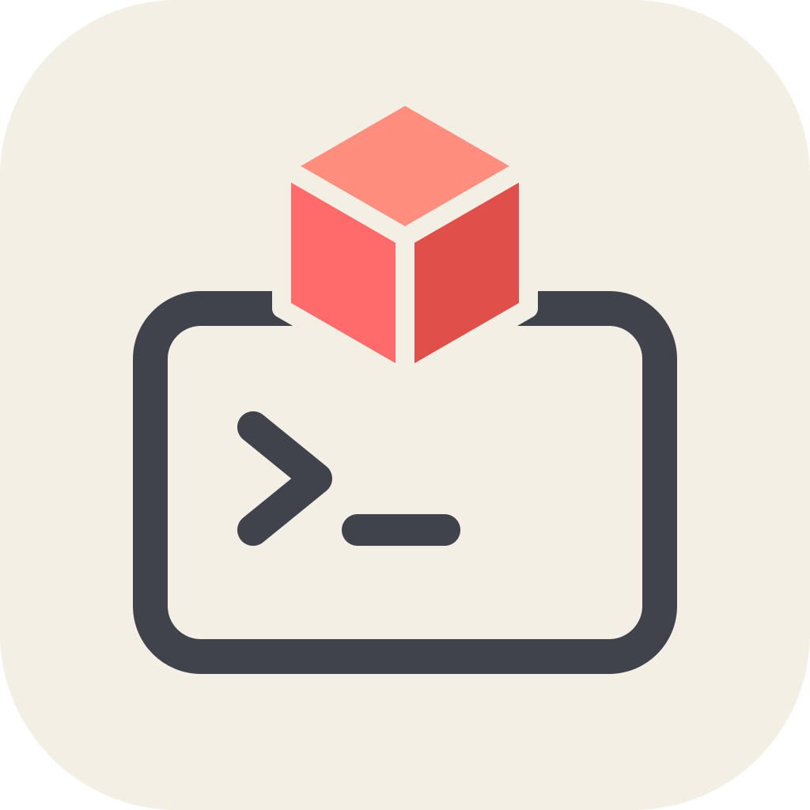
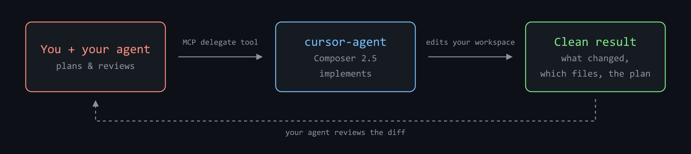
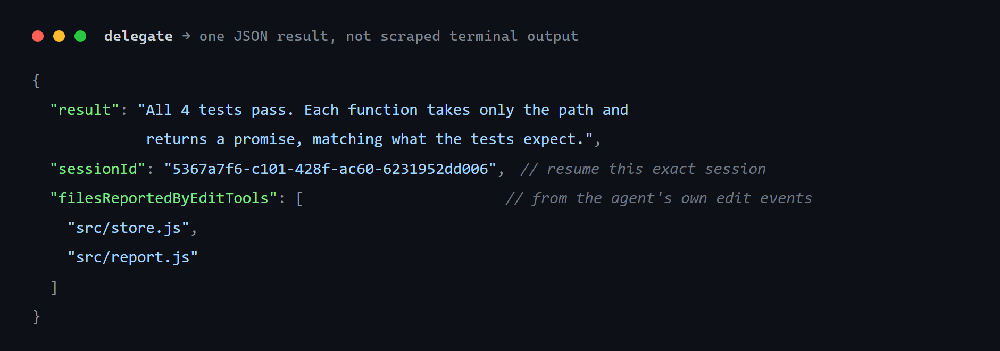

# Cursor Delegate

**Turn your coding agent into a council. Bring Composer and Grok into the conversation, then hand them the work.**

[](https://www.npmjs.com/package/cursor-delegate-mcp)
[](https://www.npmjs.com/package/cursor-delegate-mcp)
[](https://registry.modelcontextprotocol.io/v0.1/servers?search=cursor-delegate&version=latest)
[](https://glama.ai/mcp/servers/andreilungeanu/cursor-delegate-mcp)
[](https://nodejs.org)
[](LICENSE)
[](https://github.com/andreilungeanu/cursor-delegate-mcp/actions/workflows/test.yml)



Cursor Delegate is the MCP bridge to **Cursor's CLI agent**. From Claude Code, ChatGPT/Codex, Copilot or any MCP client, your agent can ask Composer or Grok for a second opinion, put one question to several models at once, or hand Cursor a plan to build, and get a structured result back from each call.

<br clear="left">


## 🧠 Get a second opinion

> Ask Grok what it thinks about moving the session store to SQLite.

Cursor reads the repo and answers in `ask` mode, and your agent sets that answer beside its own. You see where the two disagree before you choose a direction.

Ask several at once, and your agent sends each the same brief in parallel, compares the answers, and checks the claims that matter:

> Ask Composer and Grok whether we should split this service, and tell me where they disagree.

With [Codex Delegate](https://github.com/andreilungeanu/codex-delegate-mcp) or [Antigravity Delegate](https://github.com/andreilungeanu/agy-delegate-mcp) installed too, the same prompt reaches GPT or Gemini models.

## 🛠️ Hand off the work

> Delegate to Cursor: migrate src/api from callbacks to async/await and update the tests. Plan it first.

Your agent writes the brief, Cursor edits the files, and your agent reads the diff and runs the tests before it reports back.

- 📋 **Plan, approve, build** — `plan` mode returns Cursor's plan; once you approve, the same session implements it.
- 💬 **No stalled runs** — when Cursor needs a decision, it ends the turn and returns the question as a normal result. Your agent answers by resuming the same session.
- 🧵 **Resume, even on another model** — follow up in the same session with `resumeSessionId`; `effectiveModel` tells you when a different model served the turn.



## Features

- 📦 **Clean, named results** — final answer and session id, plus the files the edit tools reported, the plan, and todo progress when work is left unfinished, returned as one compact JSON payload. Nothing to scrape.
- ⏳ **Runs in the background, with MCP Tasks** — `delegate` serves the MCP Tasks extension (`io.modelcontextprotocol/tasks`), so a host that speaks it gets a task back once Cursor has the prompt and the result when Cursor finishes. In the main session of the interactive Claude Code CLI, you keep working and the result arrives as a task notification; calls from subagents wait for the result.
- 🖼️ **Attach what prose can't point at** — `contextFiles` sends screenshots, mockups and other files along with the brief.
- 🔋 **Runs on Cursor's usage pool** — Composer and Grok draw from the **Cursor Models usage pool**, separate from third-party model usage on [supported Cursor plans](https://cursor.com/help/models-and-usage/usage-limits), and separate from your host's chat quota.
- 🤝 **Native plugins** — install into Claude Code, ChatGPT/Codex, Google Antigravity, or GitHub Copilot CLI and just say *"ask Cursor"* or *"delegate this to Cursor"*. The shared skill teaches your agent to write the brief and review the result.
- 🩺 **Self-diagnosing** — a `doctor` tool that tells you exactly what's missing if setup isn't right.
- 🔌 **Portable** — plain stdio MCP, so it runs anywhere: VS Code, JetBrains, Windsurf, Visual Studio, OpenCode, Antigravity, and more.

`plan` and `ask` are instructions to the agent, and `workspace` is its working directory — [Security](SECURITY.md) and the [delegate reference](skills/delegate/reference.md) spell out what the bridge enforces and what it reports back.



## Your agent and its peers

Each plugin works on its own, and they are built to work together. Install the ones your subscriptions cover, and the agent you already use can bring Gemini 4 Neon, Carbon or Hydrogen, GPT-6.2 Sol or Astra, and Grok 4.7 or Composer 2.5 into the same conversation as peers. One question goes to all of them in parallel, and your agent sets their answers beside its own.

> Ask Gemini Neon, Codex Sol and Grok 4.7 how they would restructure the auth module, then tell me where they agree.


- [Codex Delegate](https://github.com/andreilungeanu/codex-delegate-mcp) — the OpenAI Codex CLI: GPT-6.2 Sol, GPT-6.2 Astra and the other Codex models
- **Cursor Delegate** (this one) — Cursor's CLI agent: Grok 4.7, Composer 2.5
- [Antigravity Delegate](https://github.com/andreilungeanu/agy-delegate-mcp) — Google Antigravity's CLI: Gemini 4 Neon, Carbon and Hydrogen

Model names are examples; each CLI offers what your account includes.

## Install

You need [Node.js 20+](https://nodejs.org/) and the [Cursor CLI](https://cursor.com/docs/cli/overview), logged in (`cursor-agent login`).

### Claude Code

```shell
/plugin marketplace add andreilungeanu/cursor-delegate-mcp
/plugin install cursor-delegate@cursor-delegate-mcp
```

Then just ask:

> Delegate to Cursor: migrate src/api from callbacks to async/await and update the tests, then walk me through what changed.

That's the whole loop — Claude writes the brief, Cursor grinds through the files, Claude walks you through the diff.

### ChatGPT desktop / Codex

```shell
codex plugin marketplace add andreilungeanu/cursor-delegate-mcp
codex plugin add cursor-delegate@cursor-delegate-mcp
```

### Google Antigravity

```shell
agy plugin install https://github.com/andreilungeanu/cursor-delegate-mcp
```

Restart the Antigravity app to load it. If you added `cursor-delegate` to `mcp_config.json` by hand, remove that entry.

Without the CLI, use the manual config under [Client-specific config locations](#client-specific-config-locations).

### GitHub Copilot CLI

```shell
copilot plugin marketplace add andreilungeanu/cursor-delegate-mcp
copilot plugin install cursor-delegate@cursor-delegate-mcp
```

### Any other MCP client

```json
{
  "mcpServers": {
    "cursor-delegate": {
      "command": "npx",
      "args": ["-y", "cursor-delegate-mcp"]
    }
  }
}
```

### Client-specific config locations

<details>
<summary><strong>VS Code</strong> — one-click install, or <code>.vscode/mcp.json</code></summary>

[](https://vscode.dev/redirect/mcp/install?name=cursor-delegate&config=%7B%22type%22%3A%22stdio%22%2C%22command%22%3A%22npx%22%2C%22args%22%3A%5B%22-y%22%2C%22cursor-delegate-mcp%22%5D%7D)
[](https://insiders.vscode.dev/redirect/mcp/install?name=cursor-delegate&config=%7B%22type%22%3A%22stdio%22%2C%22command%22%3A%22npx%22%2C%22args%22%3A%5B%22-y%22%2C%22cursor-delegate-mcp%22%5D%7D&quality=insiders)

Or add it manually:

```json
{
  "servers": {
    "cursor-delegate": {
      "type": "stdio",
      "command": "npx",
      "args": ["-y", "cursor-delegate-mcp"]
    }
  }
}
```

Or run **Chat: Install Plugin From Source** with this repository's URL.

</details>

<details>
<summary><strong>JetBrains AI Assistant</strong> — Settings → Tools → AI Assistant → MCP</summary>

Under **Settings → Tools → AI Assistant → Model Context Protocol (MCP)**, add a server with command `npx` and arguments `-y cursor-delegate-mcp`.

</details>

<details>
<summary><strong>Windsurf</strong> — <code>~/.codeium/windsurf/mcp_config.json</code></summary>

Same `mcpServers` block as the generic snippet above. Cascade caps you at 100 tools across all servers.

</details>

<details>
<summary><strong>Visual Studio 2022 / 2026</strong> — <code>%USERPROFILE%\.mcp.json</code></summary>

Same `servers` + `type: "stdio"` shape as VS Code. Requires Visual Studio 2026, or 2022 17.14+. Note the top-level key is `servers`, not `mcpServers`. Visual Studio also discovers `.mcp.json` next to the solution, plus `.vscode/mcp.json`.

</details>

<details>
<summary><strong>OpenCode</strong> — <code>~/.config/opencode/opencode.json</code> or project <code>opencode.json</code></summary>

OpenCode does **not** use `mcpServers`. Local servers go under `mcp`, with `type: "local"` and `command` as one array:

```json
{
  "$schema": "https://opencode.ai/config.json",
  "mcp": {
    "cursor-delegate": {
      "type": "local",
      "command": ["npx", "-y", "cursor-delegate-mcp"],
      "enabled": true
    }
  }
}
```

</details>

<details>
<summary><strong>Google Antigravity</strong> (without the plugin) — <code>~/.gemini/config/mcp_config.json</code> or workspace <code>.agents/mcp_config.json</code></summary>

```json
{
  "mcpServers": {
    "cursor-delegate": {
      "command": "npx",
      "args": ["-y", "cursor-delegate-mcp"],
      "timeoutSeconds": 21660,
      "tools": { "delegate": { "background": "always" } }
    }
  }
}
```

</details>

<details>
<summary><strong>Kiro</strong> — <code>.kiro/settings/mcp.json</code> or <code>~/.kiro/settings/mcp.json</code></summary>

Same `mcpServers` block as the generic snippet above. Workspace file wins when both exist.

</details>

<details>
<summary><strong>Kilo Code</strong> — <code>kilo.jsonc</code> (<code>mcp</code> key, not <code>mcpServers</code>)</summary>

Same shape as OpenCode: `type: "local"` and `command` as one array. In the VS Code extension: **Settings → MCP → Add Server → Local (stdio)**. On Windows, if `npx` is not found, use command `cmd` with arguments `/c`, `npx`, `-y`, `cursor-delegate-mcp`.

</details>

## License

MIT © [Andrei Lungeanu](https://github.com/andreilungeanu)

<sub>[Technical reference](TECHNICAL.md) · [Security](SECURITY.md) · [Privacy](PRIVACY.md) · [Terms](TERMS.md) · [Changelog](CHANGELOG.md)</sub>
